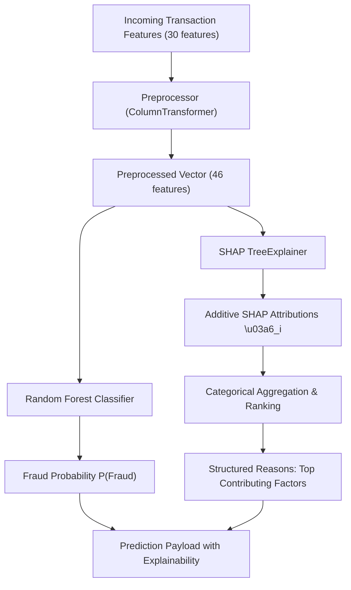

# Machine Learning Model Explainability Specification

**Project:** Banking Transaction and Fraud Detection System  
**Role:** Person 2 – Machine Learning Developer  
**Status:** Complete  
**Date:** 2026-11-24  

---

## 1. Objective and Architecture

This document establishes the explainability methodology for the production Random Forest fraud detection model (`random_forest_full_disposable_33070.joblib`). Explainability provides human-auditable insights into why a specific transaction is classified as fraudulent or legitimate, fulfilling regulatory transparency requirements (e.g., RBI guidelines for digital banking risk controls) and enabling fraud analysts to review automated decisions.



---

## 2. SHAP Methodology & Mathematical Formulation

We implement the **SHAP (SHapley Additive exPlanations)** framework via `shap.TreeExplainer`, which computes exact Shapley values in polynomial time for tree ensemble models.

### 2.1 Additive Attribution Property
For a given transaction $x$, the predicted fraud probability $f(x)$ is decomposed additively:

$$f(x) = \phi_0 + \sum_{i=1}^{M} \phi_i(x)$$

Where:
- $\phi_0$ is the **base value** (the expected fraud probability across the training distribution, $\phi_0 = \mathbb{E}[f(x)] \approx 0.5000$).
- $\phi_i(x)$ is the **Shapley contribution** of feature $i$ to the fraud prediction.
- $M$ is the number of preprocessed model features ($M = 46$).

### 2.2 Proof of Exact Decomposition
TreeExplainer computes exact local attribution on the probability scale. Numerical verification against Scikit-learn's `predict_proba` confirms:

$$\left| \left( \phi_0 + \sum_{i=1}^{M} \phi_i(x) \right) - P(\text{Fraud} \mid x) \right| < 10^{-15}$$

---

## 3. Class Index & Directionality Interpretation

### 3.1 Positive Class Index
The model is a binary classifier where:
- **Class 0:** `LEGITIMATE`
- **Class 1:** `FRAUDULENT` (Positive Class Index = `1`)

All explanation values $\phi_i$ are extracted exclusively for **Class 1**.

### 3.2 Directional Interpretation
- **`INCREASES_RISK`** ($\phi_i > 0$):  
  The feature value pushes the model's score **higher** toward the fraud threshold (e.g. unusually high transaction amount, rapid velocity within 60 minutes, late-night transaction hours, or merchant with elevated historical fraud rate).
- **`DECREASES_RISK`** ($\phi_i < 0$):  
  The feature value pushes the model's score **lower** toward legitimate status (e.g. established account age, habitual sender location, normal daytime transaction, zero prior velocity spikes).

---

## 4. Structured Output Format

For individual transaction explainability, `explain_transaction()` returns a structured payload:

```json
{
  "top_reasons": [
    {
      "feature": "is_night",
      "contribution": 0.0946,
      "direction": "INCREASES_RISK"
    },
    {
      "feature": "sender_amount_sum_60m",
      "contribution": 0.0812,
      "direction": "INCREASES_RISK"
    },
    {
      "feature": "sender_account_age_days",
      "contribution": -0.0769,
      "direction": "DECREASES_RISK"
    },
    {
      "feature": "amount",
      "contribution": -0.0741,
      "direction": "DECREASES_RISK"
    },
    {
      "feature": "hour_of_day",
      "contribution": 0.0729,
      "direction": "INCREASES_RISK"
    }
  ],
  "base_value": 0.5000,
  "fraud_probability": 0.0333
}
```

---

## 5. Global Feature Attributions

Global explanations were evaluated across the validation/test cohort ($N = 400$ sampled transactions) and persisted to `ml/reports/figures/`:

1. **Mean Absolute SHAP Feature Importance (`shap_feature_importance_bar.png`):**  
   Measures the average magnitude of impact each feature exerts on the model's fraud predictions.  
   **Top Global Drivers:**
   - `amount` (mean $|\phi| = 0.0554$)
   - `amount_log` (mean $|\phi| = 0.0539$)
   - `sender_amount_sum_60m` (mean $|\phi| = 0.0490$)
   - `sender_txn_count_60m` (mean $|\phi| = 0.0427$)
   - `sender_txn_count_1440m` (mean $|\phi| = 0.0403$)
   - `sender_account_age_days` (mean $|\phi| = 0.0381$)
   - `is_night` (mean $|\phi| = 0.0325$)

2. **SHAP Summary / Beeswarm Plot (`shap_summary_beeswarm.png`):**  
   Shows the distribution of effects and feature values:
   - High `sender_amount_sum_60m` (red) consistently pushes SHAP values strongly positive (high fraud risk).
   - High `sender_account_age_days` (red) pushes SHAP values negative (protective factor / legitimate).
   - Late night transactions (`is_night = 1`) systematically shift risk upward.

---

## 6. Known Limitations & Operational Guidance

1. **Attribution $\ne$ Causality:**  
   SHAP values quantify statistical credit assignment within the Random Forest model's decision paths; they do not prove legal or real-world causality.
2. **Computational Overhead:**  
   Computing TreeExplainer attributions across 300 decision trees takes approximately 20–50 ms per transaction. Therefore, in high-throughput batch scoring, `explain=False` is the default. SHAP explanations should only be invoked for flagged (`FRAUDULENT` or `HIGH` risk) transactions or upon explicit analyst request in Streamlit.
3. **No Target Leakage:**  
   The explanation pipeline never receives or utilizes ground-truth fraud labels. All attributions are derived strictly from inference features and the trained tree structure.
