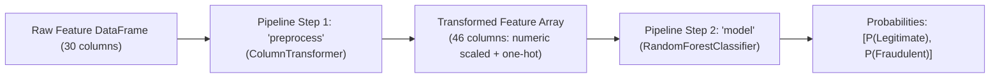

# Phase 2: Model Artifact and Inference Audit

**Project:** Banking Transaction and Fraud Detection System  
**Role:** Person 2 – Machine Learning Developer  
**Status:** Complete  
**Date:** 2026-11-24  

---

## 1. Executive Summary

This audit evaluates the saved machine learning model artifacts, preprocessing pipelines, feature contracts, and target risk encoders produced in Phase 1 and previous project milestones. The purpose is to guarantee that the inference engine (`ml/predict.py`) and explainability module (`ml/model_explainer.py`) operate with complete provenance, zero target leakage, and deterministic mathematical compatibility with Person 1's backend.

---

## 2. Artifact Inventory and Provenance Check

| Artifact Name | Path | Size | Type / Format | Provenance / Training Run | Compatibility Status |
|---|---|---|---|---|---|
| **Random Forest Full Pipeline** | `ml/models/random_forest_full_disposable_33070.joblib` | 17,081,659 bytes | Scikit-learn `Pipeline` (joblib) | Seed 42, 70/10/20 train/val/test split on `disposable_33070` | **VERIFIED COMPATIBLE** |
| **Model Metadata Sidecar** | `ml/models/random_forest_full_disposable_33070.json` | 1,838 bytes | JSON | Run sidecar with thresholds & evaluation metrics | **VERIFIED COMPATIBLE** |
| **Merchant Risk Encoder** | `ml/models/merchant_risk_encoder_disposable_33070.json` | 3,855 bytes | JSON (`MerchantRiskEncoder`) | Fit strictly on training split ($N=13,534$, 60 merchants) | **VERIFIED COMPATIBLE** |
| **Ablation Model (Reference)** | `ml/models/random_forest_ablation_no_high_risk_category_disposable_33070.joblib` | 16,946,843 bytes | Scikit-learn `Pipeline` | Feature ablation experiment | Available |
| **Logistic Regression (Baseline)** | `ml/models/logistic_regression_full_disposable_33070.joblib` | 7,610 bytes | Scikit-learn `Pipeline` | Linear baseline comparison | Available |

### Provenance & Compatibility Verification
1. **Identical Training Source:** Both the Random Forest pipeline and the MerchantRiskEncoder were produced using the dataset source tag `disposable_33070` on the exact same 19,335 synthetic transaction dataset.
2. **Deterministic Splitting:** Both artifacts adhere to the chronological split rule:
   - Training ($N = 13,534$, 414 fraud cases, 3.0585% base rate)
   - Validation ($N = 1,934$, 59 fraud cases)
   - Testing ($N = 3,867$, 135 fraud cases)
3. **Independent Loading Test:** Both `.joblib` and `.json` artifacts load independently in Python without requiring a live database connection or raw training data.

---

## 3. Model Architecture & Pipeline Internals

The saved Random Forest artifact is an end-to-end Scikit-learn `Pipeline` consisting of two sequential stages:

### Preprocessing (`preprocess` step: `ColumnTransformer`)
1. **Numeric Transformer (`'numeric'`):**
   - Applied to the 27 continuous and binary indicator features.
   - Sub-pipeline:
     - `SimpleImputer(strategy='median')`: Imputes missing continuous values (safety net).
     - `StandardScaler()`: Zero-mean, unit-variance standardization.
2. **Categorical Transformer (`'categorical'`):**
   - Applied to the 3 categorical columns: `['sender_account_type', 'receiver_shape', 'merchant_category']`.
   - Sub-pipeline:
     - `SimpleImputer(strategy='constant', fill_value='MISSING')`.
     - `OneHotEncoder(handle_unknown='ignore')`: Expands the 3 categorical columns into 19 binary indicator columns.
3. **Total Feature Dimensionality:** $27 \text{ numeric} + 19 \text{ one-hot} = 46 \text{ preprocessed features}$.

### Estimator (`model` step: `RandomForestClassifier`)
- `n_estimators`: 300
- `class_weight`: `'balanced_subsample'`
- `random_state`: 42
- `max_depth`: `None`
- `min_samples_leaf`: 1

---

## 4. Feature Schema & Ordering Contract

The Scikit-learn pipeline requires exactly **30 columns** in the following designated order:

### 4.1 Numeric Features (27 columns)
1. `amount` (float)
2. `amount_log` (float)
3. `amount_zscore_sender` (float)
4. `hour_of_day` (int, 0–23)
5. `day_of_week` (int, 0–6)
6. `is_night` (int, 0 or 1)
7. `is_festival_day` (int, 0 or 1)
8. `sender_account_age_days` (int, $\ge 0$)
9. `has_sender_history` (int, 0 or 1)
10. `sender_txn_count_10m` (int, $\ge 0$)
11. `sender_txn_count_60m` (int, $\ge 0$)
12. `sender_txn_count_1440m` (int, $\ge 0$)
13. `sender_amount_sum_60m` (float, $\ge 0$)
14. `is_new_receiver` (int, 0 or 1)
15. `sender_fanout_60m` (float, $\ge 0$)
16. `sender_fanout_1440m` (float, $\ge 0$)
17. `is_high_risk_category` (int, 0 or 1)
18. `is_new_merchant_for_customer` (int, 0 or 1)
19. `has_device_id` (int, 0 or 1)
20. `has_ip_address` (int, 0 or 1)
21. `has_location` (int, 0 or 1)
22. `has_card_token` (int, 0 or 1)
23. `is_merchant_missing` (int, 0 or 1)
24. `device_changed_for_account` (int, 0 or 1)
25. `location_changed_for_account` (int, 0 or 1)
26. `has_device_history` (int, 0 or 1)
27. `merchant_risk_rate` (float, looked up from `MerchantRiskEncoder`)

### 4.2 Categorical Features (3 columns)
28. `sender_account_type` (str: `'Savings'`, `'Current'`)
29. `receiver_shape` (str: `'account_only'`, `'account_and_upi'`, `'external_upi_only'`, `'NOT_APPLICABLE'`)
30. `merchant_category` (str: category name or `'NOT_APPLICABLE'`)

---

## 5. Thresholds, Metrics & Risk Status Separation

### 5.1 Classification Threshold
- **Threshold Value:** **`0.2100`**
- Verified test set performance at threshold 0.21:
  - ROC-AUC: **0.9651**
  - PR-AUC: **0.6534**
  - Precision: **0.4802** (48.02%)
  - Recall: **0.7185** (71.85%)
  - Confusion Matrix: $TN=3627, FP=105, FN=38, TP=97$

### 5.2 Operational Risk Status Mapping
Operational risk classification is decoupled from binary decision logic:
- `LOW`: $0.00 \le \text{fraud\_probability} < 0.10$
- `MEDIUM`: $0.10 \le \text{fraud\_probability} < 0.21$
- `HIGH`: $0.21 \le \text{fraud\_probability} \le 1.00$

---

## 6. Inference Context & Limitations

### Historical Context Dependency
`build_features()` computes time-windowed aggregates (e.g. sender transactions in the last 10, 60, and 1440 minutes, z-scores, device changes).
- **Batch Mode:** When scoring an extracted batch of transactions ordered by timestamp, `build_features()` processes the entire table chronologically.
- **Single-Transaction Mode:** Real-time scoring of an individual transaction requires the sender's preceding historical window (e.g., past 24 hours of transactions) or precomputed feature values.
- **Strict Prohibition:** `ml/predict.py` will not silently substitute arbitrary zeros or dummy values for missing history. If insufficient context is provided, it validates input cleanly and reports explicit validation errors.

---

## 7. Audit Conclusion & Phase 2 Readiness

1. The model pipeline (`random_forest_full_disposable_33070.joblib`) and encoder (`merchant_risk_encoder_disposable_33070.json`) are fully compatible and verified.
2. `shap` (v0.54.1) is installed and confirmed to decompose tree predictions with $10^{-15}$ numerical precision against Scikit-learn's `predict_proba`.
3. Preprocessing and feature alignment are fully self-contained. Phase 2 implementation can proceed immediately.
