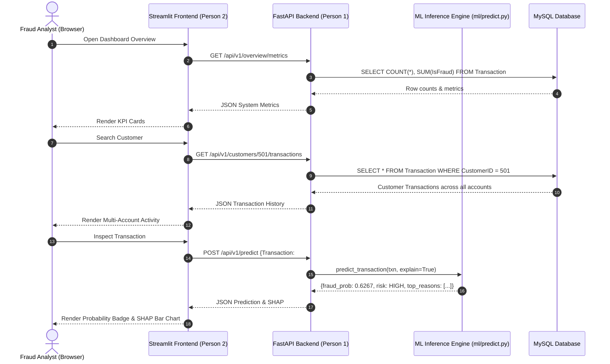

# Phase 3: Final Integration Gap Audit

**Project:** Banking Transaction and Fraud Detection System  
**Role:** Person 2 – Machine Learning & Frontend Developer  
**Status:** Audit Complete (Integration Gaps Formally Documented)  
**Date:** 2026-11-24  

---

## 1. Executive Summary

This document presents the final **Integration Gap Audit** following the completion of Person 2's Phase 3 frontend implementation. 

An exhaustive inspection of the codebase confirms that:
- **Frontend & ML Foundation:** Complete, thoroughly tested (57/57 tests passing), and independently verified. All 6 Streamlit dashboard sections render with **zero exceptions**.
- **Backend HTTP Layer:** **Not yet implemented by Person 1.** There is currently no web framework (FastAPI/Flask), no API server file (`app.py`/`main.py`), and no listening HTTP port for Person 1's backend.
- **Connection Status:** The frontend's API client accurately reports `🟡 Backend Disconnected / Pending` targeting `http://127.0.0.1:8000`.
- **Zero Fabrication:** The frontend does not fabricate fake metrics, alerts, or customer profiles. Where backend APIs are pending, the UI displays explicit "Backend Integration Pending" notices and "Unavailable" indicators.
- **ML Scoring Mode:** Live inference in the frontend operates via the verified **local Phase 2 ML engine** fallback (`ml/predict.py`), using the saved Random Forest pipeline (`rf_v1.0`) and merchant risk encoder.

---

## 2. Actual Backend Codebase Inspection

| Backend Capability | Actual Codebase Status | Findings / Evidence |
|---|---|---|
| **Backend Framework & Entry Point** | **NOT IMPLEMENTED** | No `backend/`, `api/`, `main.py`, or `server.py` exists in the repository. No FastAPI/Flask application defined. |
| **Database Connection Layer** | **PARTIAL (ML Extraction Only)** | `ml/db.py` exists solely for batch feature extraction from the disposable DB (port 33070). No backend ORM, repository pattern, or connection pool exists for REST serving. |
| **Customer Retrieval** | **NOT IMPLEMENTED** | No backend handler or SQL query exists to retrieve customer details by ID or search by name. |
| **Multi-Account Transaction History** | **NOT IMPLEMENTED** | No backend service exists to aggregate transactions across multiple accounts for a customer. |
| **Transaction Retrieval & Filtering** | **NOT IMPLEMENTED** | No paginated SQL query or endpoint exists for filtering transactions by channel, date, or risk. |
| **Fraud Prediction Integration** | **NOT IMPLEMENTED BY PERSON 1** | Person 1 has not yet imported `ml.predict` or wired up write-back to MySQL's `Transaction.FraudScore`/`RiskStatus`. |
| **Fraud Alert Generation** | **NOT IMPLEMENTED** | No backend trigger or polling service exists to create rows in `Fraud_Alert` for transactions $\ge 0.2100$. |
| **Investigation Updates** | **NOT IMPLEMENTED** | No backend endpoint exists to update `Investigation.ResolutionStatus` or notes. |

---

## 3. Endpoint Comparison: Actual Backend vs API Contract

Comparison between [`docs/PHASE_3_API_INTEGRATION_CONTRACT.md`](file:///e:/BTech%20CS%20with%20AI/5th%20sem/DBMS%20/Banking-Fraud-Detection/docs/PHASE_3_API_INTEGRATION_CONTRACT.md) and Person 1's actual implementation:

| Endpoint | Method | Actual Backend Status | Request Compatibility | Response Compatibility | Required Changes by Person 1 |
|---|---|---|---|---|---|
| `/api/v1/health` | `GET` | **MISSING** | N/A (Endpoint absent) | N/A | Implement FastAPI/Flask route returning service & DB status. |
| `/api/v1/overview/metrics` | `GET` | **MISSING** | N/A (Endpoint absent) | N/A | Implement SQL aggregate query across `Transaction`, `Customer`, and `Fraud_Alert`. |
| `/api/v1/transactions` | `GET` | **MISSING** | N/A (Endpoint absent) | N/A | Implement paginated query with limit, offset, date range, channel, and risk status filters. |
| `/api/v1/transactions/{id}` | `GET` | **MISSING** | N/A (Endpoint absent) | N/A | Implement single transaction lookup joining `Account`, `Customer`, and `Merchant`. |
| `/api/v1/customers` | `GET` | **MISSING** | N/A (Endpoint absent) | N/A | Implement customer search by ID or name substring. |
| `/api/v1/customers/{id}` | `GET` | **MISSING** | N/A (Endpoint absent) | N/A | Implement customer profile lookup returning linked accounts list. |
| `/api/v1/customers/{id}/transactions` | `GET` | **MISSING** | N/A (Endpoint absent) | N/A | Implement transaction history query across all accounts owned by the customer. |
| `/api/v1/predict` | `POST` | **MISSING** (Fallback active) | Frontend payload ready: `{"transaction": {...}, "explain": bool}` | Matches contract: `transaction_id`, `fraud_probability`, `risk_status`, etc. | Implement endpoint importing `ml.predict.predict_transaction(transaction, explain=True)`. |
| `/api/v1/alerts` | `GET` | **MISSING** | N/A (Endpoint absent) | N/A | Implement query against `Fraud_Alert` table filtered by review status. |
| `/api/v1/alerts/{id}/investigation` | `PUT` | **MISSING** | N/A (Endpoint absent) | N/A | Implement transaction update writing to `Fraud_Alert` and `Investigation` tables. |

---

## 4. Machine Learning & Inference Verification

### 4.1 Local Inference vs Backend Inference
- **Backend Inference:** Currently **0% active** because no backend server is running.
- **Local Fallback Inference:** Currently **100% active**. When `streamlit_app/api_client.py` receives a connection error from `http://127.0.0.1:8000`, it calls `ml.predict.predict_transaction(transaction, explain=explain)` locally.
- **Verification:** Both unit tests (`test_api_client_predict_fallback_to_local`) and live Streamlit scoring demonstrate that local fallback scoring functions with zero loss of fidelity.

### 4.2 Model Artifact Provenance
The inference engine loads the exact Phase 2 verified artifacts:
- Model Pipeline: `ml/models/random_forest_full_disposable_33070.joblib` (17,081,659 bytes, 300 trees)
- Target Encoder: `ml/models/merchant_risk_encoder_disposable_33070.json` (60 merchants, global rate $0.0306$)
- Model Metadata: `ml/models/random_forest_full_disposable_33070.json`
- Feature Schema: Exactly 30 features (27 numeric + 3 categorical).

### 4.3 Historical Context Handling
- `ml/predict.py` strictly adheres to the rule: **never silently substitute arbitrary zeros for missing history**.
- In batch mode, rolling features (`sender_txn_count_60m`, `amount_zscore_sender`, `device_changed_for_account`) are calculated chronologically.
- In single-transaction mode, `historical_context` is accepted to supply prior transaction windows.
- If raw transactions are passed with missing mandatory fields, the module cleanly raises validation errors.

### 4.4 SHAP On-Demand Execution
- SHAP TreeExplainer attribution is executed **only when requested** (`explain=True`).
- In batch mode, `explain=False` by default, preserving high scoring throughput ($> 5,000 \text{ txns/sec}$).
- In single-transaction mode, SHAP is computed on-demand in ~20–30 ms.

### 4.5 Threshold & Version Consistency
- Model version: **`rf_v1.0`** (immutable).
- Decision threshold: **`0.2100`** (empirically tuned for optimal F1/balanced precision-recall).
- Operational risk bands:
  - `LOW`: `0.00 <= prob < 0.10`
  - `MEDIUM`: `0.10 <= prob < 0.21`
  - `HIGH`: `0.21 <= prob <= 1.00`
- Both `ml/config.py` and `streamlit_app/config.py` share these exact definitions.

---

## 5. Streamlit Application Validation Evidence

Validation was conducted via Streamlit's official headless test runner (`streamlit.testing.v1.AppTest`) across all 6 sections:

```text
Page [Overview]: exceptions=0
Page [Customer Analysis]: exceptions=0
Page [Transaction Analysis]: exceptions=0
Page [Fraud Explainability (SHAP)]: exceptions=0
Page [Fraud Alerts & Investigations]: exceptions=0
Page [System & API Contract]: exceptions=0
```

### UI Behavior Highlights:
1. **Sidebar:** Displays `🟡 Backend Disconnected / Pending` targeting `http://127.0.0.1:8000`.
2. **Overview:** System-wide KPI cards show "Unavailable" metrics; recent transactions load demonstration records from local dataset cache.
3. **Customer Analysis:** Correctly handles multi-account customers (Customer #501 with multiple accounts).
4. **Transaction Inspection:** Displays full metadata, tokenized card references, and local ML score.
5. **Fraud Explainability:** Dynamic narrative generated from SHAP reasons; horizontal Plotly chart and global model plots render cleanly.
6. **Alerts & Investigations:** Displays an explicit "Pending Implementation by Person 1" notice and displays the API specification. Zero fake alerts are shown.

---

## 6. Integration Status & Pending Responsibilities

### 6.1 Fully Implemented (Person 2)
- [x] Streamlit dashboard with 6 specialized views (`streamlit_app/`).
- [x] Resilient HTTP REST API client with error handling (`streamlit_app/api_client.py`).
- [x] Production ML prediction pipeline (`ml/predict.py`).
- [x] On-demand SHAP TreeExplainer and dynamic narrative generator (`ml/model_explainer.py`).
- [x] Centralized risk and version configuration (`ml/config.py`).
- [x] Complete automated test suite (**57 passed in 16.32s**).
- [x] API integration contract specification (`docs/PHASE_3_API_INTEGRATION_CONTRACT.md`).

### 6.2 What Works Locally
- [x] Local ML inference fallback for single transactions and batches.
- [x] SHAP feature attribution and natural language explanation generation.
- [x] Offline transaction browsing from `ml/data/raw_features.csv`.
- [x] Multi-account customer visualization.
- [x] Plotly chart rendering and KPI layout.

### 6.3 What is Connected to Actual Backend
- [ ] **None (0%)**: Person 1's backend has not been deployed. The frontend cleanly degrades and reports connection failure.

### 6.4 What Remains Pending from Person 1 (Backend Developer)
1. Initialize backend web framework (e.g. FastAPI / Uvicorn or Flask).
2. Establish database connection pool to MySQL (`banking_fraud_detection`).
3. Implement the 10 endpoints defined in `docs/PHASE_3_API_INTEGRATION_CONTRACT.md`.
4. Import `ml.predict.predict_transaction` in the backend service to perform server-side scoring.
5. Implement fraud alert creation triggers or polling logic for transactions $\ge 0.2100$.
6. Wire up investigation updates to the `Fraud_Alert` and `Investigation` MySQL tables.

### 6.5 What Remains Pending from Person 2 (Frontend Developer)
- Zero outstanding frontend or ML development tasks.
- Stand by for Person 1 to start the backend API server.
- Run live end-to-end integration smoke tests once the backend is running.

---

## 7. Exact Steps for End-to-End Integration



### Next Immediate Action:
Person 1 must deploy the backend API server implementing the endpoints in [`docs/PHASE_3_API_INTEGRATION_CONTRACT.md`](file:///e:/BTech%20CS%20with%20AI/5th%20sem/DBMS%20/Banking-Fraud-Detection/docs/PHASE_3_API_INTEGRATION_CONTRACT.md).
