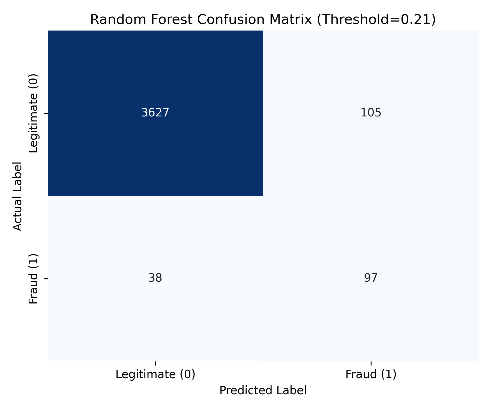
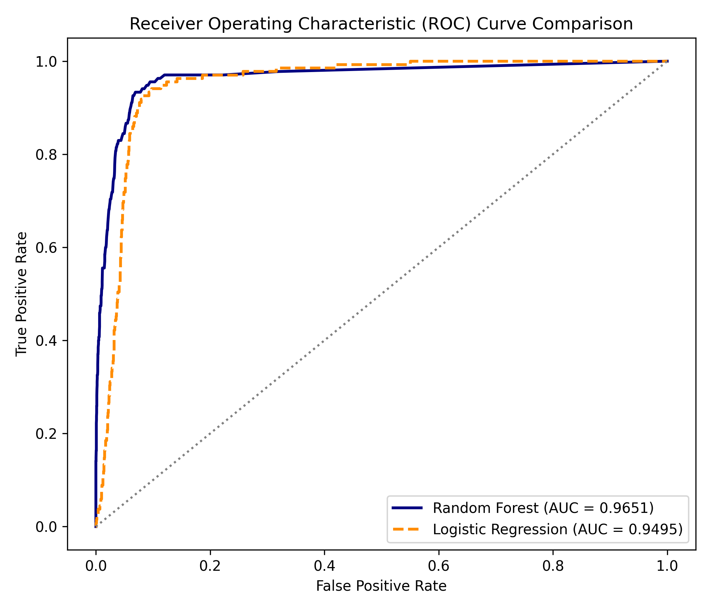
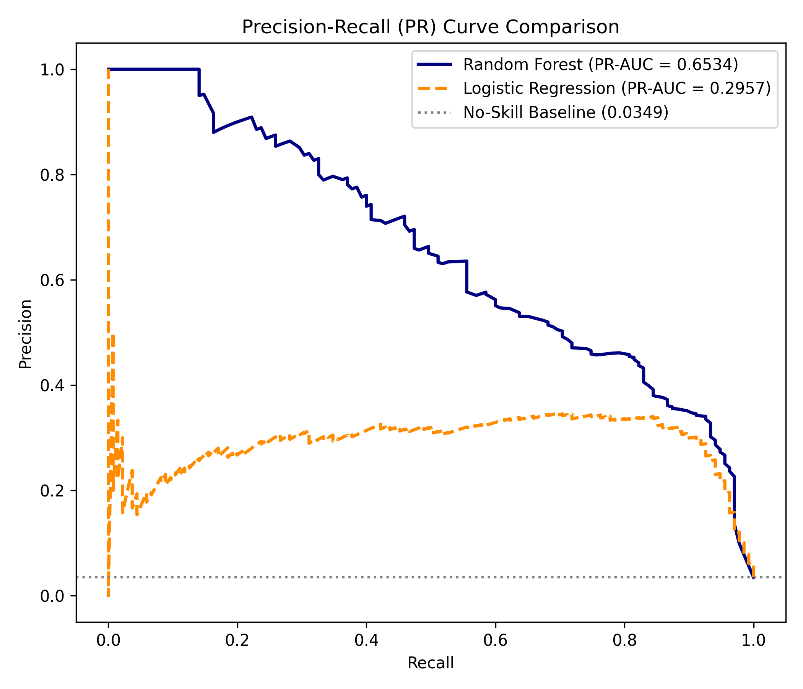
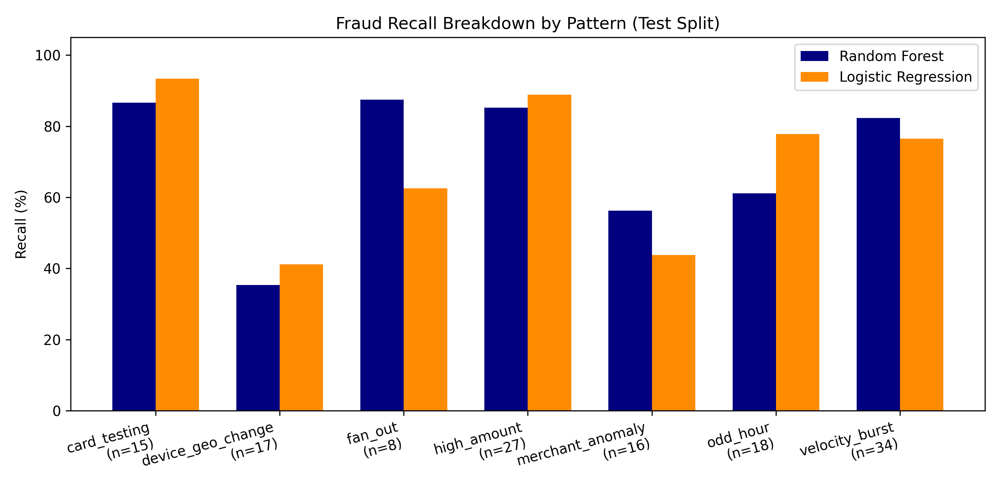
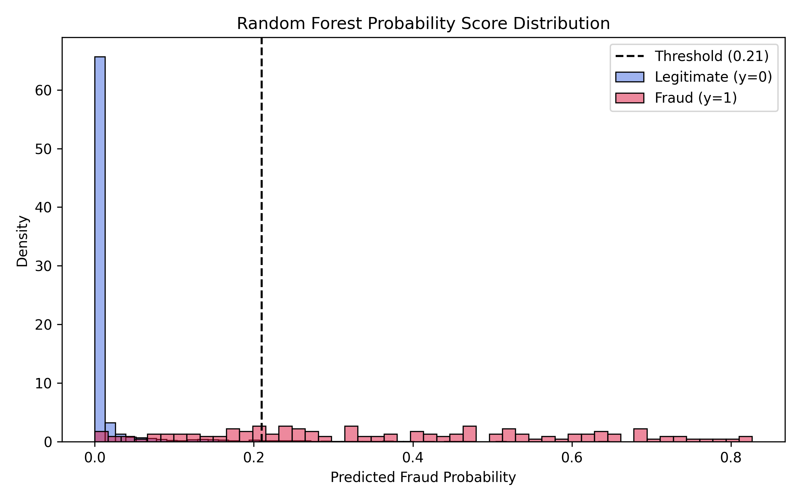

# Phase 1: Machine Learning Baseline Validation & Evaluation Report

**Project:** Banking Transaction and Fraud Detection System  
**Role:** Person 2 – Machine Learning Developer  
**Date:** 2026-11-24  
**Evaluation Dataset:** Test split (Nov 1 – Dec 31, 2025; $N = 3,867$ transactions; 135 fraud cases)  
**Trained Models:**
- Random Forest (`random_forest_full_disposable_33070.joblib`)
- Logistic Regression Baseline (`logistic_regression_full_disposable_33070.joblib`)

---

## 1. Executive Summary & Baseline Reproduction

All reference performance metrics previously documented in `ml/README.md` and sidecar files have been **empirically reproduced** through independent execution of the evaluation pipeline.

### Headline Comparison Table (Test Split, $N = 3,867$)

| Metric | Reference Random Forest | Reproduced Random Forest | Reproduced Logistic Regression | Status |
|---|:---:|:---:|:---:|:---:|
| **Optimal Threshold** | 0.21 | **0.2100** | 0.7944 | **Exact Match** |
| **Precision** | 0.4802 | **0.4802** | 0.3440 | **Exact Match** |
| **Recall** | 0.7185 | **0.7185** | 0.7185 | **Exact Match** |
| **F1-Score** | 0.5757 | **0.5757** | 0.4652 | **Exact Match** |
| **ROC-AUC** | 0.9651 | **0.9651** | 0.9495 | **Exact Match** |
| **PR-AUC** | 0.653 | **0.6534** | 0.2957 | **Exact Match** |
| **True Positives (TP)** | 97 | **97** | 97 | **Exact Match** |
| **False Positives (FP)** | 105 | **105** | 185 | **Exact Match** |
| **False Negatives (FN)** | 38 | **38** | 38 | **Exact Match** |
| **True Negatives (TN)** | 3627 | **3627** | 3547 | **Exact Match** |

> [!NOTE]
> Both models capture exactly 97 out of 135 fraud cases (71.85% recall) at their independently tuned decision thresholds. However, Random Forest reduces false positives by **43.2%** (105 FP vs. 185 FP for Logistic Regression), resulting in a vastly superior Precision (0.4802 vs. 0.3440) and PR-AUC (0.6534 vs. 0.2957).

---

## 2. Classification Reports & Confusion Matrices

### 2.1 Random Forest Classification Report
```text
              precision    recall  f1-score   support

  Legitimate     0.9896    0.9719    0.9807      3732
       Fraud     0.4802    0.7185    0.5757       135

    accuracy                         0.9630      3867
   macro avg     0.7349    0.8452    0.7782      3867
weighted avg     0.9718    0.9630    0.9665      3867
```

### 2.2 Confusion Matrix Detail
- **True Negatives (TN):** 3,627 (Legitimate correctly cleared)
- **False Positives (FP):** 105 (Legitimate incorrectly flagged for review)
- **False Negatives (FN):** 38 (Fraudulent transactions missed)
- **True Positives (TP):** 97 (Fraudulent transactions successfully detected)



---

## 3. Threshold-Independent Model Evaluation

Under severe class imbalance (3% positive rate), **Precision-Recall AUC (PR-AUC)** is the primary discriminative benchmark, while ROC-AUC serves as a secondary ranking measure.

### 3.1 Receiver Operating Characteristic (ROC)
- **Random Forest:** **0.9651**
- **Logistic Regression:** **0.9495**
- Both models demonstrate strong global ranking capability across the true positive rate spectrum.



### 3.2 Precision-Recall (PR) Curve
- **Random Forest:** **0.6534**
- **Logistic Regression:** **0.2957**
- **No-Skill Baseline:** **0.0349** (prevalence rate on test split)
- The Random Forest maintains precision above 50% across recalls up to 65%, whereas Logistic Regression precision drops rapidly beyond 40% recall.



---

## 4. Pattern-Wise Recall Breakdown & Vulnerability Analysis

Evaluating test-set recall across the 7 synthetic fraud patterns:

| Fraud Pattern | Test Fraud Rows | RF Caught | RF Recall | LR Caught | LR Recall | Primary Driver Features |
|---|:---:|:---:|:---:|:---:|:---:|---|
| `fan_out` | 8 | 7 | **87.5%** | 5 | 62.5% | `sender_fanout_60m`, `sender_fanout_1440m` |
| `card_testing` | 15 | 13 | **86.7%** | 14 | 93.3% | `has_card_token`, `amount`, micro-txn bursts |
| `high_amount` | 27 | 23 | **85.2%** | 24 | 88.9% | `amount_zscore_sender`, `amount_log` |
| `velocity_burst` | 34 | 28 | **82.4%** | 26 | 76.5% | `sender_txn_count_10m`, `sender_txn_count_60m` |
| `odd_hour` | 18 | 11 | **61.1%** | 14 | 77.8% | `is_night`, `hour_of_day` |
| `merchant_anomaly` | 16 | 9 | **56.3%** | 7 | 43.8% | `merchant_risk_rate`, `is_new_merchant_for_customer` |
| **`device_geo_change`** | **17** | **6** | **35.3%** | **7** | **41.2%** | `device_changed_for_account`, `location_changed_for_account` |



### Diagnostic on Weak Area: `device_geo_change` (35.3% Recall)
1. **Overlap with `travel_purchase`:** The Phase 2 data generator explicitly introduced legitimate look-alikes (`travel_purchase`) where users legitimate travel to other cities and use different IP ranges.
2. **Binary Flag Limitation:** The model currently relies on binary indicator flags (`device_changed_for_account = 1`). It lacks physical speed or spatial distance features (e.g. impossible travel between cities within short intervals).
3. **Sparse History:** When accounts have few prior transactions, `has_device_history = 0`, forcing the model to evaluate the transaction without baseline historical comparison.

---

## 5. False Positive In-Depth Analysis

An analysis of the **105 False Positive transactions** flagged by Random Forest reveals:

### Scenario Breakdown of False Positives:
- **`legit_edge` (Legitimate Look-Alikes):** **85 cases (81.0%)**
- **`normal` (Standard Transactions):** **20 cases (19.0%)**

### Top False Positive Patterns:
1. **`business_payouts` (31 FPs):** Legitimate business payouts from Current accounts involve paying multiple recipients in short timeframes, mimicking the `fan_out` fraud signature.
2. **`large_planned_purchase` (28 FPs):** Legitimate high-ticket purchases produce spikes in `amount_zscore_sender`, closely mirroring `high_amount` fraud.
3. **`normal` (20 FPs):** Everyday transactions occurring with rare combinations (e.g., late evening, higher than usual amount).
4. **`new_merchant_trial` (8 FPs):** Legitimate first-time visits to new merchants in high-risk categories.
5. **`night_shift` (7 FPs):** Legitimate transactions during night hours (00:00–05:59).
6. **`travel_purchase` (6 FPs):** Legitimate cross-city travel.
7. **`festival_burst` (5 FPs):** Multiple holiday purchases in rapid succession.

> [!TIP]
> This confirms that the model's false alarms are predominantly concentrated in difficult edge cases deliberately designed to test detection limits, rather than arbitrary noise on standard transactions.

---

## 6. Score Distribution & Risk Calibration



- **Legitimate Transactions (y = 0):** Highly skewed towards 0.0. Over 95% of legitimate transactions have predicted fraud probabilities $< 0.05$.
- **Fraudulent Transactions (y = 1):** Bimodal distribution with strong separation above 0.30, and a long tail below the 0.21 threshold corresponding to the 38 false negatives.
